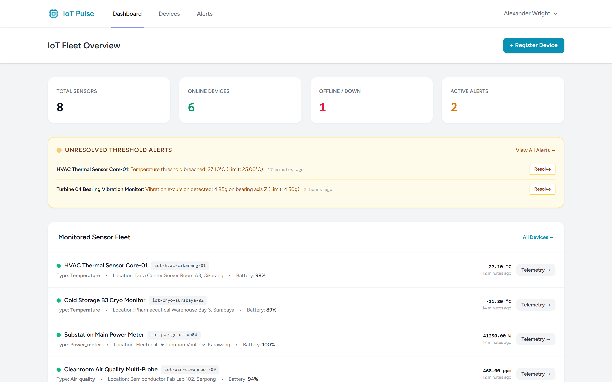
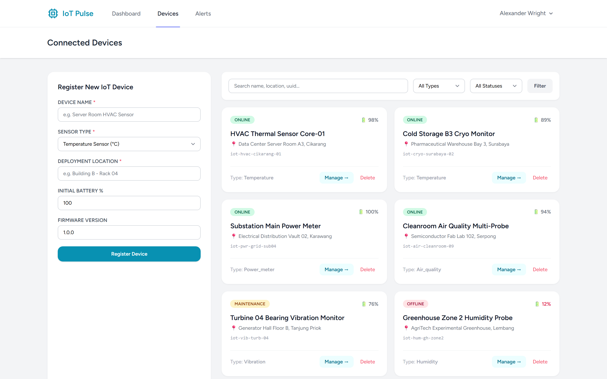
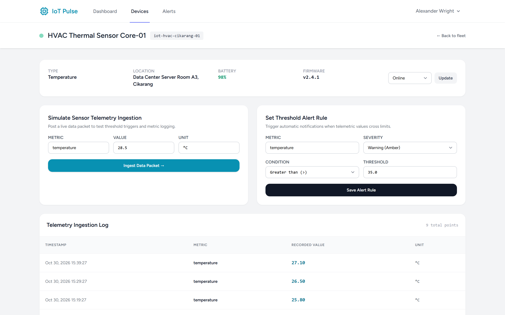
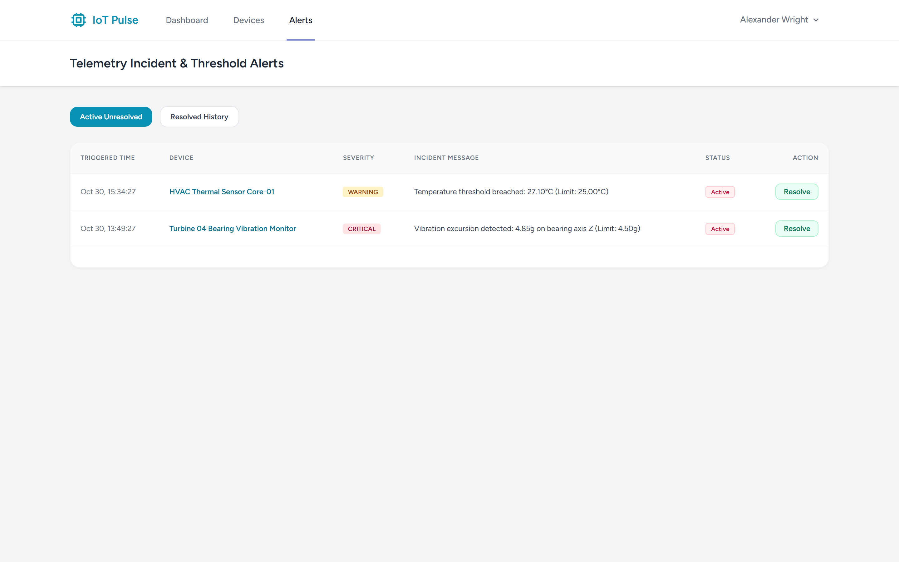

# IoT Monitoring Dashboard (Laravel 12 / Breeze / Tailwind / SQLite)

A modern, real-time IoT hardware telemetry and fleet monitoring platform built with Laravel, Tailwind CSS, and Blade. Features device registry, multi-metric telemetry ingestion, condition-based alert rule evaluation, incident alerting, and hardware health tracking.

## Features

- **Device Fleet Management**: Register hardware devices with unique UUIDs, sensor types (temperature, humidity, air quality, power, vibration), deployment locations, battery indicators, and firmware versioning.
- **Real-Time Telemetry Ingestion**: Ingest live sensor packets with values, units, and timestamps, automatically updating device ping times and operational statuses.
- **Dynamic Threshold Rules**: Create customizable alert rules with comparative conditions (`>`, `<`, `>=`, `<=`), threshold limits, and severity tiers (`critical`, `warning`, `info`).
- **Automated Incident Alerting**: Real-time threshold evaluation on telemetry ingest in `DB::transaction()` with full audit trail and resolution tracking.
- **Modern Responsive Dashboard**: Fleet KPIs, active breach notifications, telemetry streams, and hardware details.

## Screenshots

| Tampilan | Preview |
|---|---|
| **Dashboard Pemantauan Armada IoT**<br>Ringkasan metrik kesehatan perangkat online/offline, indikator baterai, insiden peringatan aktif, dan log telemetri terbaru |  |
| **Inventaris & Registrasi Perangkat**<br>Manajemen katalog sensor hardware, pencarian/filter multi-parameter, dan form onboarding perangkat baru |  |
| **Aliran Telemetri & Aturan Ambang Batas**<br>Rincian spesifikasi sensor, konfigurasi batas kondisi darurat (Threshold Rules), dan riwayat data telemetri historis |  |
| **Pusat Insiden & Resolusi Peringatan**<br>Daftar peringatan batas sensor kritis/peringatan, validasi nilai pelanggaran terhadap ambang batas, dan aksi resolusi insiden |  |

---

## Tech Stack

- **Backend**: Laravel 12.x (PHP 8.3+)
- **Authentication**: Laravel Breeze
- **Database**: SQLite (local & testing), PostgreSQL ready
- **Frontend**: Blade, Tailwind CSS, Vite

## Setup & Testing

```bash
cp .env.example .env
php artisan key:generate
touch database/database.sqlite
php artisan migrate
npm install
npm run build
php artisan test
```
